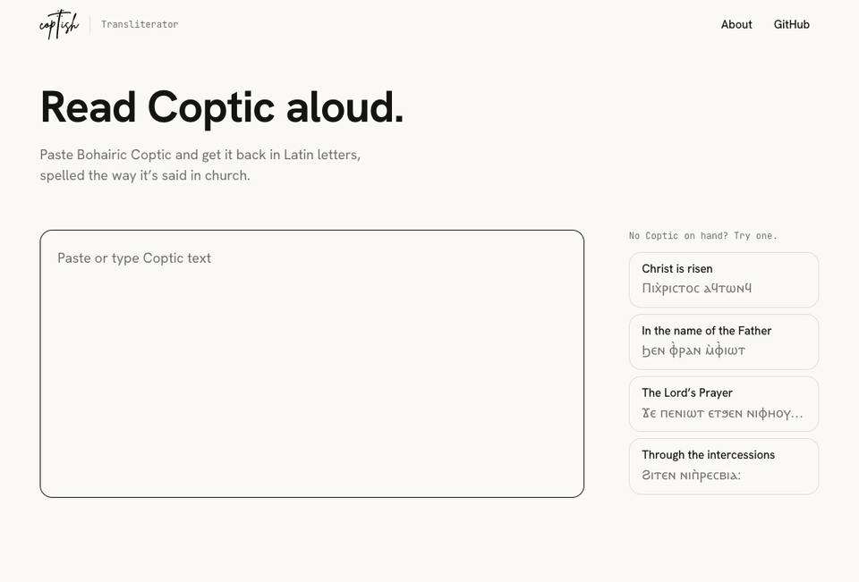

<picture>
  <source media="(prefers-color-scheme: dark)" srcset="docs/readme/coptish-logo-white.png">
  
</picture>

# Coptic Transliterator

Paste Bohairic Coptic and get it back in Latin letters, spelled the way it's said in church.

**[Try it](https://coptish-transliterator.vercel.app)** · [About Coptish](https://coptish-transliterator.vercel.app/about)



## How it works

**Three readings, one text.** Each transliteration runs three Gemini calls in parallel: one at temperature 0 and two sampled at 0.7. [`lib/merge-readings.ts`](lib/merge-readings.ts) aligns them word by word and marks only the words they disagree on. The reader taps a mark to choose the version that sounds right.

**The jinkim, handled in code.** The model kept dropping the *e* that a jinkim stands for, so [`lib/jinkim.ts`](lib/jinkim.ts) writes it into the Coptic before the request is sent (ⲛ̀ⲧⲉ becomes ⲉⲛⲧⲉ, read *ente*).

**Measured, not guessed.** [`data/reference.json`](data/reference.json) holds example pairs, which go into the prompt, and held-out pairs, which never do. `npm run eval` scores every prompt or model change against the held-out set. The current setup gets 63% of the held-out lines exactly right and 98.4% of characters. In that run, 4 of its 5 marks landed where the first reading was wrong.

**Long hymns, bite by bite.** A paste of up to 16,000 characters is split into parts of at most 4,000, at a stanza break first, then a line break, then punctuation ([`lib/split-parts.ts`](lib/split-parts.ts)). The reader settles one part and moves on to the next.

**Free and private.** Next.js on Vercel's free tier, `gemini-3.5-flash-lite` on Gemini's free tier, and no database. The API key stays on the server, and nothing a reader types is stored or logged.

## Spelling

Greco-Bohairic pronunciation, the one used in Coptic Orthodox liturgy, written with plain Latin letters and no accents. The full rules are in [`lib/prompt.ts`](lib/prompt.ts).

| Coptic | Latin | Example |
|---|---|---|
| ⲏ | ee | ϣⲏⲣⲓ → sheeri |
| ⲱ | o | ⲑⲱⲕ → thok |
| ϧ | kh | ⲉⲧϧⲉⲛ → etkhen |
| ϭ | ch | Ⲡ̀ϭⲟⲓⲥ → Epchois |
| ϫ | j before ⲉ, ⲓ or ⲏ, otherwise g | ϩⲓϫⲉⲛ → hijen, ϯϫⲟⲙ → tigom |
| ⲃ | v, but b at the end of a word | ⲉ̀ⲃⲟⲗ → evol, ⲉⲑⲟⲩⲁⲃ → ethouab |
| ⲭ | k in Coptic words, kh in Greek ones | ⲭⲁ → ka, Ⲡⲓⲭ̀ⲣⲓⲥⲧⲟⲥ → Pikhristos |
| a jinkim on a consonant | an e before it | ⲛ̀ⲧⲉ → ente |
| an overlined name | spelled out in full | Ⲡⲭ̅ⲥ̅ → Pikhristos |

## Run it locally

You need Node 20.9 or later and a free Gemini API key from [Google AI Studio](https://aistudio.google.com/apikey).

```sh
npm install
echo "GEMINI_API_KEY=your-key" > .env.local
npm run dev      # http://localhost:3000
npm test         # unit tests
npm run eval     # scores the held-out pairs with real Gemini calls, so it uses quota
```

## Contribute

Found a word spelled wrong? [Open an issue](https://github.com/markrofail/coptish-transliterator/issues) with the Coptic, what came back and what you expected.

You can also add it to [`data/reference.json`](data/reference.json) as a pair: `{ "coptic": "…", "latin": "…", "split": "heldout" }`. Held-out pairs are only used to score changes, so they never leak into the prompt. Mark a pair `"example"` only when it should teach the model a pattern.

## Part of Coptish

*Our Coptic heritage, made accessible.* Coptish is a project to make Coptic more accessible, so anyone in church can read along, pray along and learn. This transliterator is one part of it.

- [coptish-datastore](https://github.com/markrofail/coptish-datastore): Coptic Orthodox texts in English, Arabic, Coptic and Coptic-English
- [coptish-app-reactnative](https://github.com/markrofail/coptish-app-reactnative): the Coptish app, in progress
- [coptish-datastore-editor](https://github.com/markrofail/coptish-datastore-editor): an editor for the datastore

## Licence

The code is under the [MIT licence](LICENSE). Two things in this repository are not covered by it:

- the CS Ava Veni font in `app/fonts/`, used with permission, with all rights remaining with its authors
- the Coptish logo (`public/coptish-logo.png` and `docs/readme/coptish-logo-*.png`)
